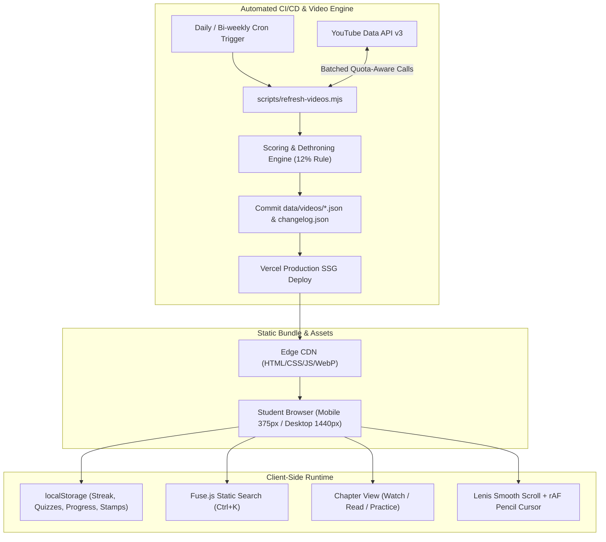

# Architecture & System Design: Codex / Marginalia

## 1. System Overview & Philosophy
Codex (working title: Marginalia) is a high-performance, mobile-first educational platform designed for engineering and IT self-learners. The system is engineered to run at **zero recurring hosting cost** with **zero database dependencies in v1**, leveraging static site generation (SSG), client-side persistence (`localStorage`), static search indexing, and automated GitOps via GitHub Actions.



---

## 2. Directory Structure

```text
/
├── .github/
│   └── workflows/
│       ├── refresh-videos.yml       # Scheduled GitHub Action for video pipeline
│       └── build-verification.yml   # CI lint, typecheck, static build check
├── content/                         # Canonical course curriculum & notes
│   ├── LICENSES.json                # Legal ledger of all open-source & CC materials
│   ├── ai-ml/
│   │   ├── 01-what-ai-ml-really-are/
│   │   │   ├── meta.json            # Chapter metadata, hours, prerequisites, volatility
│   │   │   ├── notes.mdx            # 7-section open-license notes
│   │   │   └── quiz.json            # 8-10 original conceptual & scenario questions
│   │   └── ... (Chapters 02 to 10)
│   ├── cybersecurity/
│   │   ├── 01-security-foundations/
│   │   └── ... (Chapters 02 to 11)
│   └── iot/
│       ├── 01-iot-architecture/
│       └── ... (Chapters 02 to 10)
├── data/
│   └── videos/
│       ├── ranking.config.json      # Scoring weights, volatility decay factors, allow-list
│       ├── recipes.json             # Search queries & keyword constraints per chapter
│       ├── cache.json               # YouTube API cache (reduces quota usage)
│       ├── changelog.json           # Historical log of video shifts (#1 changes)
│       ├── ai-ml.json               # Ranked top 5 videos for all AI & ML chapters
│       ├── cybersecurity.json       # Ranked top 5 videos for Cybersecurity chapters
│       └── iot.json                 # Ranked top 5 videos for IoT chapters
├── scripts/
│   ├── refresh-videos.mjs           # Autonomous YouTube API ranking & verification script
│   ├── build-search-index.mjs       # Pre-compiles search index for instant Cmd+K
│   └── verify-content.mjs           # Quality checks: missing quizzes, bad licenses, dead links
├── src/
│   ├── app/
│   │   ├── layout.tsx               # Root layout, Google Fonts, theme injector, desk provider
│   │   ├── page.tsx                 # Home: 3 giant doors, changelog strip, how it works, CTA
│   │   ├── my-desk/page.tsx         # Personal progress, streak, completion rings, bookmarked
│   │   ├── sources/page.tsx         # Open source ledger & credit transparency
│   │   ├── about/page.tsx           # Mission, editorial manifesto, self-learning philosophy
│   │   ├── not-found.tsx            # Playful 404 with pencil doodle illustration
│   │   └── [courseSlug]/
│   │       ├── page.tsx             # Course roadmap (sketched winding road / mobile timeline)
│   │       └── [chapterSlug]/
│   │           └── page.tsx         # Chapter page: Watch / Read / Practice tabs + TOC
│   ├── components/
│   │   ├── course/                  # Roadmap, tier dividers, course headers
│   │   ├── chapter/                 # WatchFacade, ReadNotes, QuizWidget, TabNav, ScorePopover
│   │   ├── desk/                    # ProgressRings, StreakCounter, ContinueCard
│   │   ├── layout/                  # NavigationRail, MobileNav, Footer, ThemeMorpher
│   │   ├── search/                  # CommandPalette (Ctrl+K)
│   │   ├── motion/                  # PencilCursor, ScrollProgress, MagneticButton, Doodle
│   │   └── ui/                      # Button, Card, Badge, Modal, Tooltip, Stamp
│   ├── lib/
│   │   ├── content.ts               # MDX parsing, chapter traversal, prerequisites checker
│   │   ├── storage.ts               # Type-safe localStorage API with sync & validation
│   │   ├── search.ts                # Client-side fuzzy search driver
│   │   └── utils.ts                 # Formatting, classnames merger
│   └── styles/
│       ├── globals.css              # CSS variables, typography utility, grain overlays
│       └── themes.css               # "Sunrise Paper", "Midnight Ledger", "Blueprint Meadow"
├── ARCHITECTURE.md
├── DESIGN_SYSTEM.md
├── CONTENT_RULES.md
├── README.md
├── package.json
└── tailwind.config.ts
```

---

## 3. Technology Stack & Tradeoff Analysis

| Layer | Chosen Tool | Justification & Alternatives Considered |
|---|---|---|
| **Framework** | **Next.js (App Router, SSG)** | Zero runtime server cost on Vercel; pages are fully pre-rendered at build time for instant mobile loading; SEO friendly. Alternative Vite SPA lacks static MDX pre-rendering and OpenGraph generation. |
| **Styling** | **Tailwind CSS + CSS Variables** | Native utility speed, zero runtime overhead. CSS variable tokens enable seamless runtime theme morphing (`sunrise`, `midnight`, `blueprint`) across courses without style recalculation lag. |
| **Markdown / MDX** | **next-mdx-remote / compileMDX** | Lightweight, fast build times, supports custom interactive React components (SVG diagrams, callouts, copy-code blocks) without complex webpack loader chains. |
| **Motion** | **Framer Motion + @studio-freight/lenis** | *Lenis* provides buttery smooth scroll with zero layout hijacking and full accessibility/keyboard support. *Framer Motion* handles layout animations, sticky tab transitions, and door expansions cleanly. |
| **Cursor System** | **Custom Canvas/SVG + rAF** | Pure native requestAnimationFrame running outside React render cycle; renders pencil tip, fading graphite trail, and highlighter modes without frame drops. Disabled on mobile/touch and `prefers-reduced-motion`. |
| **Search** | **Fuse.js (Static Pre-indexed)** | Pre-compiled JSON index at build time. Zero backend calls. Lightning-fast response under 10ms for instant Ctrl+K navigation even on slow 2G connections. |

---

## 4. YouTube API Quota Budget & Strategy

### Quota Constraints
- Daily YouTube Data API v3 Free Tier Quota: **10,000 units / day**.
- `search.list` call cost: **100 units** (expensive!).
- `videos.list` call cost: **1 unit** (up to 50 video IDs per call, very cheap).

### Total Platform Surface
- Total Chapters across 3 courses: 10 + 11 + 10 = **31 chapters**.

### Budget Breakdown
1. **Full Search Strategy**:
   - Running `search.list` for 31 chapters = $31 \times 100 = \mathbf{3,100\text{ units}}$.
   - Running `videos.list` (batching all candidates in chunks of 50) = $\approx \mathbf{5\text{ units}}$.
   - Total run cost = $\approx \mathbf{3,105\text{ units}}$ ($31\%$ of daily free quota).
2. **Execution Frequency**:
   - **Weekly automated run** (e.g., every Sunday at 00:00 UTC) via GitHub Actions comfortably uses only 3,105 units out of the 10,000 allowance for that single day.
   - For fast-moving volatility chapters, a mid-week delta search can run targeting only "fast-moving" chapters (approx 10 chapters = 1,000 units).
   - This leaves an enormous safety margin (>65%) to avoid quota exhaustion.
3. **Graceful Fallback ("Sample Data Mode")**:
   - If `YOUTUBE_API_KEY` is not present in local development or CI, the build engine operates in **Sample Mode**, loading high-fidelity curated reference videos tagged with `[SAMPLE MODE - CONFIGURE YOUTUBE_API_KEY FOR LIVE POLLING]`. No fake metrics or hallucinated video IDs are ever emitted.

---

## 5. Client-Side Persistence & Student State (`localStorage`)

To provide instant progress tracking without requiring user registration or a backend database:
- Key: `codex_student_state_v1`
- Schema:
  ```ts
  interface StudentState {
    streak: {
      currentCount: number;
      lastActiveDate: string; // YYYY-MM-DD
    };
    chapters: {
      [chapterId: string]: {
        completed: boolean;
        lastVisited: string;
        quizBestScore: number;
        earnedStamp: boolean;
        incorrectQuestionIds: string[];
      };
    };
    recentlyWatchedVideos: string[];
    settings: {
      reducedMotion: boolean;
      soundEffects: boolean;
    };
  }
  ```
- Instant rehydration with zero hydration mismatch using an event-driven `useStudentStore` React hook.
